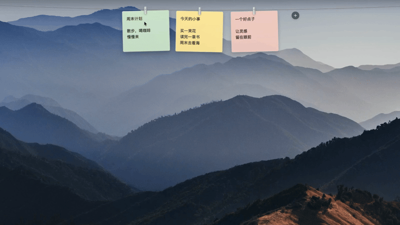

<p align="center">
  
</p>

<h1 align="center">String Notes · 绳上便笺</h1>

<p align="center"><strong>Hang a thought. Keep it in sight.</strong></p>

<p align="center">
  Native macOS menu bar notes for little tasks, passing ideas, and things you want to remember.
</p>

<p align="center">
  <a href="https://github.com/TD21forever/string-notes/releases/tag/v0.11.1"></a>
  
  
  <a href="LICENSE"></a>
</p>

<p align="center"><strong>English</strong> · <a href="README.zh-CN.md">简体中文</a></p>

<p align="center">
  <a href="#install">Install</a> ·
  <a href="#get-started">Get started</a> ·
  <a href="#your-notes-and-backups">Your notes & backups</a> ·
  <a href="https://github.com/TD21forever/string-notes/issues">Report an issue</a>
</p>

Pause your pointer over the menu bar and a string of colorful notes slides into view. Open a note to catch a thought, drag its clip to move it along the string, and archive it when you are done. Tuck the string away when you want to focus.

Built with **Swift, SwiftUI, and AppKit**. No account required. Your notes and images stay on your Mac.

> The app supports English and Simplified Chinese. It follows your system language by default; change it in Settings → General → Language and restart the app. Existing notes are never translated.

## See it in action

[](https://github.com/TD21forever/string-notes/raw/refs/heads/main/Assets/demo/string-notes.mp4)

[Watch or download the full 16-second video with music](https://github.com/TD21forever/string-notes/raw/refs/heads/main/Assets/demo/string-notes.mp4). Recorded on a real Mac; the demo uses the Chinese interface. [Media credits](Assets/demo/README.md).

## At a glance


A real screenshot with four quick-start notes. From left to right:

1. **Catch a thought** — click **＋**, write, and let autosave take care of it.
2. **Pull it down** — drag a note downward to open its own window, or simply click it.
3. **Hang it back** — drag the window's empty title area to the string; neighboring cards make room before you release.
4. **Close with confidence** — pin a note to keep it on top, press **Esc** to save and close, or archive it when done.

## A place for the little things

| | What String Notes offers |
| --- | --- |
| **Keep it in sight** | Colorful notes on a transparent string. Drag a note or clip to reorder it, pull it down to open a window, then drag the window back to hang it up. Empty overlay areas let clicks pass through. |
| **Catch a thought** | Open notes from the menu bar or a global shortcut. Changes save automatically, with multiple note windows and individual always-on-top controls. |
| **Make yourself at home** | Native text editing, find, undo and redo, adjustable fonts and sizes, and common Markdown formatting. |
| **Add more than words** | Paste or insert images. Drag their corner handles to resize them; each image remembers its own size. |
| **Put things away** | Search a simpler library with just Notes and Archive. Archive finished notes and hang them back whenever you need them. |
| **Set your own rhythm** | Customize global shortcuts, turn off hover-to-reveal, reduce motion, and export a complete backup whenever you need one. |

## Install

Available for **Apple Silicon (M-series)** and **Intel Macs**, with a minimum build target of **macOS 13 Ventura**. Intel builds are checked in GitHub’s Intel macOS environment; interactive use on an Intel Mac and the minimum macOS version still need broader testing.

### Download DMG

1. Download the DMG for your Mac: [Apple Silicon](https://github.com/TD21forever/string-notes/releases/download/v0.11.1/StringNotes-0.11.1-arm64.dmg) or [Intel](https://github.com/TD21forever/string-notes/releases/download/v0.11.1/StringNotes-0.11.1-x86_64.dmg).
2. Open the disk image and drag **绳上便笺.app** to **Applications**.
3. Open the app from Applications. When upgrading, quit the old app before replacing it. Your existing notes stay on this Mac.

Prefer a ZIP? Download [StringNotes-0.11.1-arm64.zip](https://github.com/TD21forever/string-notes/releases/download/v0.11.1/StringNotes-0.11.1-arm64.zip), unzip it, and move the app to Applications. An [Intel ZIP](https://github.com/TD21forever/string-notes/releases/download/v0.11.1/StringNotes-0.11.1-x86_64.zip) is also available. Both formats contain the same app. SHA-256 checksum files are available on the [release page](https://github.com/TD21forever/string-notes/releases/tag/v0.11.1).

### Homebrew

```bash
brew install --cask TD21forever/tap/string-notes
```

### If macOS blocks the first launch

This preview is ad-hoc signed, without a Developer ID signature or Apple notarization. **DMG, ZIP, and Homebrew installations may all require manual approval.**

If you downloaded the app from this project's release page and trust it:

1. Try opening the app, then dismiss the warning with **Done**.
2. Open **System Settings → Privacy & Security**, find the message about String Notes, and click **Open Anyway**.
3. Follow the macOS confirmation prompts, then open the app again.

The option may depend on your macOS version and device management policy. See [Apple's instructions](https://support.apple.com/102445). No step requires disabling Gatekeeper for the whole system. Your notes are stored separately in `~/Library/Application Support/StringNotes`; replacing the app does not remove them.

<details>
<summary>Upgrade or uninstall with Homebrew</summary>

Upgrade:

```bash
brew update
brew upgrade --cask TD21forever/tap/string-notes
```

Uninstall the app:

```bash
brew uninstall --cask string-notes
```

A normal uninstall keeps your local notes. The cask does not define a `zap` action that removes user data.

</details>

## Get started

1. **Reveal the string.** Click the note icon in the menu bar, or pause your pointer over the menu bar.
2. **Hang your first note.** Click **＋** beside the string and start writing. Changes save automatically.
3. **Arrange your thoughts.** Click a note to edit it, or drag it along the string to reorder it. Pull a note down to open a separate window; drag the window’s empty title area back to the string to hang it up. Closing a detached window also returns the note to the string.
4. **Archive what is done.** Archive a note, then find it in the library (**所有便笺**) whenever you want to read it or hang it back on the string.

Right-click the menu bar icon to open the library, settings (**设置**), or quit the app.

<details>
<summary>Keyboard shortcuts</summary>

Global shortcuts can be changed or cleared in settings. They do not require Accessibility permission.

| Action | Default global shortcut |
| --- | --- |
| New note | ⌃⌥⌘N |
| Open the library | ⌃⌥⌘A |
| Open the archive | ⌃⌥⌘L |
| Show / hide the string | ⌃⌥⌘S |

Inside the editor:

| Action | Shortcut |
| --- | --- |
| New line | Return |
| Find | ⌘F |
| Undo / redo | ⌘Z / ⇧⌘Z |
| Save and close | ⌘Return |
| Dismiss find; otherwise save and close | Esc |
| New note | ⌘N |
| Open settings | ⌘, |

</details>

<details>
<summary>Markdown support</summary>

Live formatting supports headings, emphasis, code, quotes, lists, and task text.

Task lists are currently formatted text; their checkboxes cannot be clicked to toggle completion. The editor is not a full CommonMark implementation.

</details>

## Your notes and backups

**Notes are stored locally on your Mac. No account is needed, and there is currently no automatic cloud sync.** In settings, choose the complete backup export (**完整备份 → 导出**) to save text, images, archived notes, and retained recovery records together. Export a backup before moving to a new Mac or trying a new version.

Importing a backup merges new notes. When an ID already exists, the local version is kept. **Import does not overwrite existing notes and cannot roll back edits to them.**

<details>
<summary>Storage location and save protection</summary>

- Notes: `~/Library/Application Support/StringNotes/notes.json`.
- Images are included as RTFD attachments inside the data file, preserving their original data. Preferences use local UserDefaults.
- Writes use atomic replacement. Corrupt files and unknown data versions are protected from being overwritten.
- Closing an editor or quitting the app triggers a final save. If saving fails, the window stays open or quitting is blocked.
- When legacy array data is first migrated, a copy is kept as `notes-before-v3.json`.

</details>

## Preview status and feedback

This is the **0.11.1**. Isolated tests cover storage, backup merging, corrupt-data protection, image persistence and resizing, Markdown, reorder data logic, and multiple editing sessions. UI behavior still needs broader testing across macOS versions, displays, Chinese input methods, and Spaces.

The library now has only Notes and Archive. Draft recovery is merged into the note list; there is no separate Drafts or Trash tab. Deleted records remain in local storage and backups, but there is currently no restore action in the UI. Archive notes you may want to revisit.

Choose **Check for Updates…** from the menu bar icon to check GitHub releases, including previews. Settings → Data & About offers release notes and the download for your Mac. Automatic checks happen on launch at most once per day and can be disabled. After downloading, quit the app and replace it in Applications; this does not install updates automatically. Homebrew users can keep using `brew upgrade --cask TD21forever/tap/string-notes`.

Automatic cloud sync, automatic version history, and a notarized distribution are not available yet.

Found a problem or have an idea? Open an [issue](https://github.com/TD21forever/string-notes/issues). For bugs, include the app version, macOS version, chip type, and steps to reproduce. Hide private note content before sharing screenshots.

## Local development

<details>
<summary>Get the source, build, and test</summary>

Requires macOS and Xcode Command Line Tools.

```bash
git clone https://github.com/TD21forever/string-notes.git
cd string-notes

# Build the app
./build.sh

# Run isolated tests
python3 tests/check-store.py

# Package a release ZIP and generate its SHA256
./scripts/package.sh
```

The app is written to `build/`; release files are written to `dist/`. [VERSION](VERSION) sets the version number.

The default build is `arm64`. Use `STRING_NOTES_ARCH=x86_64 ./scripts/package.sh` for Intel, then `STRING_NOTES_ARCH=x86_64 ./scripts/package-dmg.sh` for its DMG. Homebrew selects the matching architecture automatically. After changing the icons, run `./scripts/build-icons.sh` to regenerate the icon resources.

GitHub Actions runs the isolated tests and packages the app. Pushing a `v*` tag that matches `VERSION` creates a preview release. Update the version and checksum in the [Homebrew tap](https://github.com/TD21forever/homebrew-tap) after publishing.

</details>

## License and thanks

String Notes is available under the [MIT License](LICENSE), with its own name and custom-drawn icons.

Thanks to [Tendedero](https://github.com/alejandrobujan/tendedero) for the string-and-clips idea. The string, metal clips, and transparent overlay were adapted from Tendedero; some editing behavior was adapted from [Noty](https://github.com/aimen08/noty). See [THIRD_PARTY_NOTICES.md](THIRD_PARTY_NOTICES.md) for attribution and licenses.
